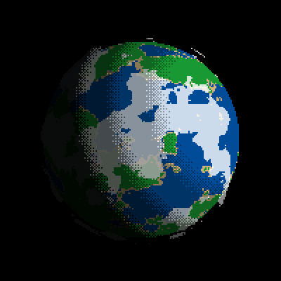
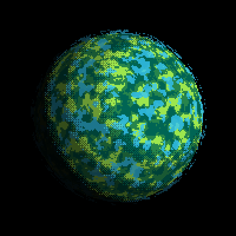
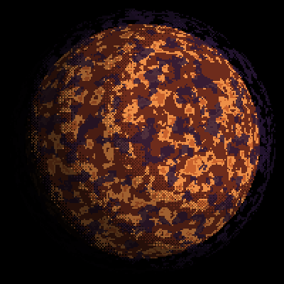
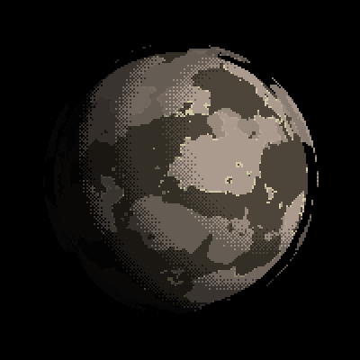

# Planet Generator

<table>
  <tr>
    <td></td>
    <td></td>
  </tr>
  <tr>
    <td></td>
    <td></td>
  </tr>
</table>

## Features

This project generates random planets using Pygame, ModernGL and GLSL shaders. 

* Customisable Procedudural Planet Generation using parameters set to render with GLSL fragment shader
* Saving/Loading from PNGs, encoding the save settings into the image using LSB steganography
* Saving to GIFs

## How To Run

Mac/Linux:
```sh
python3 -m venv .venv
. .venv/bin/Activate
pip3 install -r requirements.txt
python3 main.py
```

Windows:
```sh
python3 -m venv .venv
.\.venv\Scripts\activate
pip3 install -r requirements.txt
python3 main.py
```

## Instructions

* Space Bar - Cycle new procedurally generated planet
* S Key - Save Photo of Planet with my hand picked optimal lighting direction (Includes settings encoded through LSB)
* C Key - Save Photo of Planet exactly how it looks on frame pressed (Includes settings encoded through LSB)
* G Key - Save to GIF at project root at `planet.gif` (Does **NOT** contain planet settings)

To change settings alter `MODE` in `main.py`. Valid options of `MODE` are as follows:
* `"default"` - loads earth like default settings as seen above
* `"random"` - loads a procedurally generated planet on first run
* `"filepath/of/encoded/image.png"` - loads the settings of a previously encoded image e.g. `"/showcase-planets/images/planet_1.png"`

You can also alter the procedural generation algorithm and settings in `generator.py`.

## Credits

Inspired by [DaFluffyPotato](https://github.com/DaFluffyPotato)'s planet generator project.